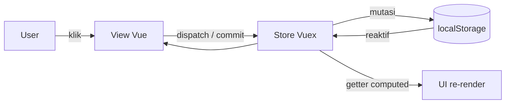
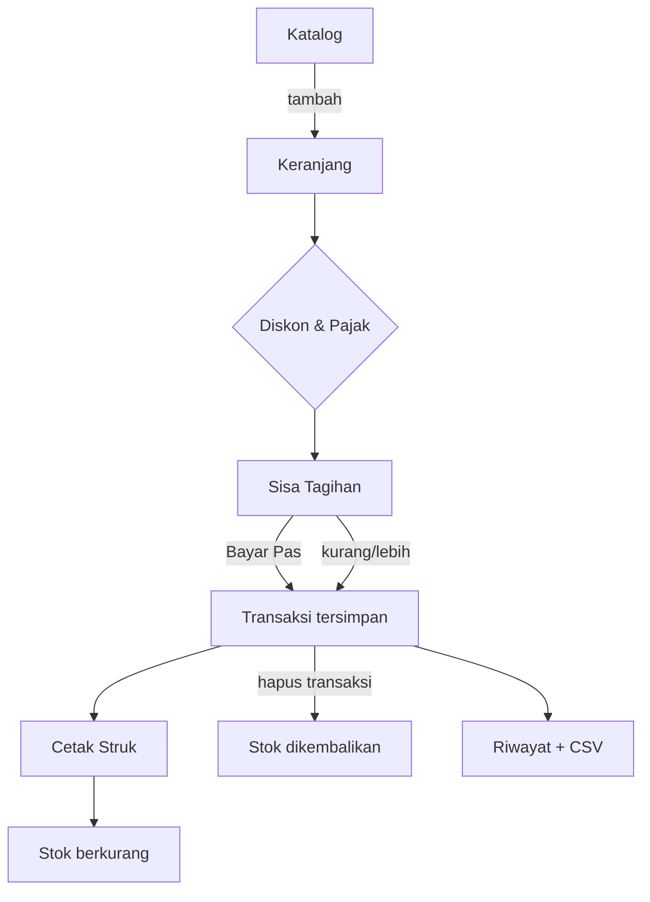
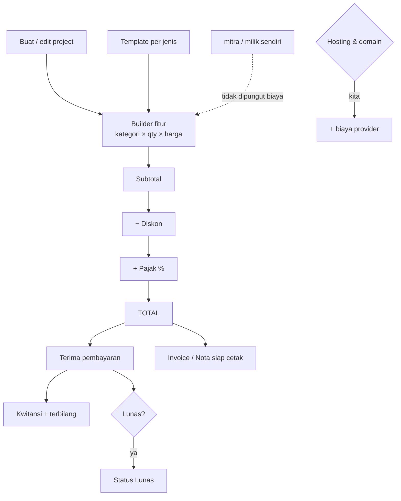
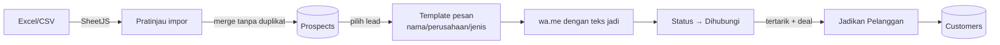
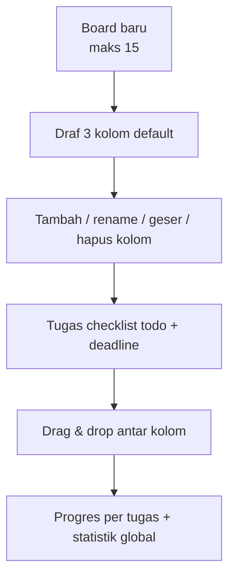
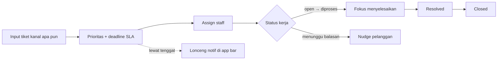
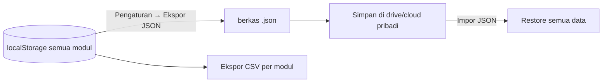
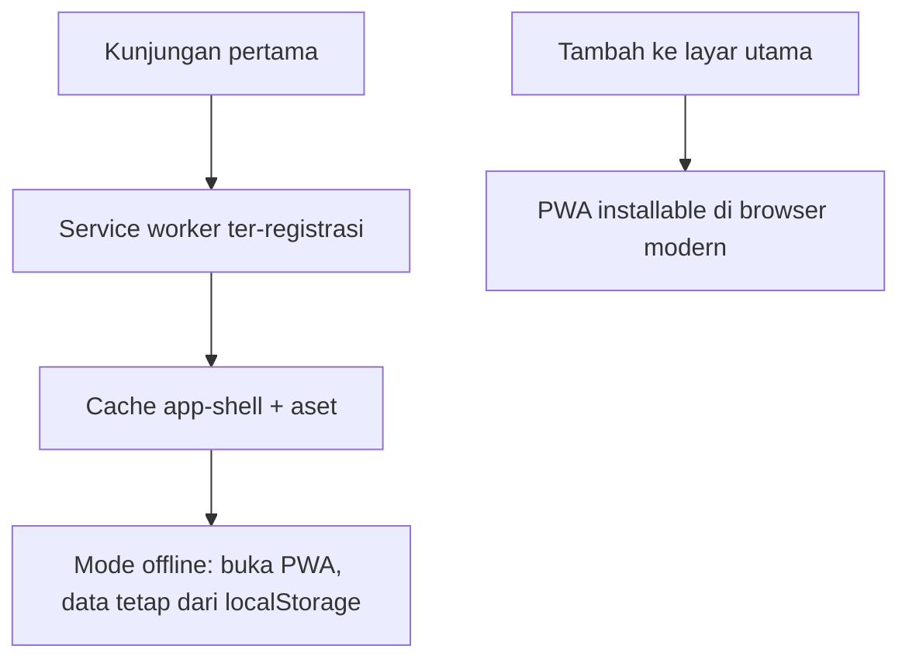
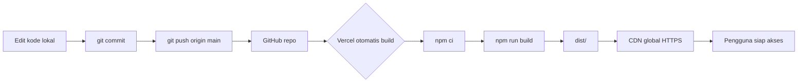

# Service Management Tools (Layananku)


Aplikasi layanan pelanggan & manajemen bisnis **all-in-one** (PWA — installable, berjalan offline, **tanpa backend**, semua data tersimpan di localStorage perangkat Anda).

> 💡 Karena memakai hash router (`#/`) dan `publicPath` relatif, `dist/index.html` bisa dibuka langsung dari disk, dihosting di host apa pun, atau dideploy ke Vercel tanpa konfigurasi tambahan.

---

## 📑 Daftar Isi

- [Fungsi Tiap Menu](#-fungsi-tiap-menu)
- [Diagram Alur](#-diagram-alur)
- [Tech Stack](#-tech-stack)
- [Keamanan](#-keamanan)
- [Menjalankan & Deploy](#-menjalankan--deploy)
- [Struktur Proyek](#-struktur-proyek)

---

## 🧭 Fungsi Tiap Menu

### 1. Dashboard
Pusat ringkasan harian: KPI tiket (terbuka/diproses/lewat tenggat), pelanggan aktif, omzet harian, agenda hari ini, dan notifikasi stok menipis. Semua angka dihitung langsung dari Vuex getter, tanpa polling API.

### 2. Data Mitra (`/mitras`)
Database mitra/pelanggan project:
- CRUD lengkap + jenis perorangan/badan usaha, status prospect/aktif/nonaktif.
- Kolom **Project Dipesan** — daftar project terkait mitra dengan status & hitungan nilai.
- Kolom nilai kontrak agregat + kartu statistik total kontrak & tagihan belum lunas.
- Detail inline: kontak, alamat, catatan, daftar project, tombol **Buat Project** (auto-terisi mitra), cetak invoice/kwitansi terakhir.

### 3. Data Project (`/projects`)
Mesin penjualan jasa digital:
- 11 jenis project siap pakai (ERP, SIMRS, LMS, CMS, EMS, POS, Company Profile, Landing Page, Web Profil Bisnis, E-Commerce, Undangan Digital).
- Builder **kategori fitur & harga** — tambah/ganti nama/hapus fitur, qty, harga, atau muat template fitur per jenis project lalu sesuaikan.
- Penanggung jawab **hosting & domain**: milik mitra, milik sendiri, atau ditanggung kita (dengan provider/spesifikasi/domain/harga per tahun).
- Perhitungan: subtotal fitur + hosting − diskon + pajak %, pembayaran bertahap, sisa tagihan, penanda Lunas.
- **Cetak Invoice / Nota / Kwitansi** (termasuk terbilang Rupiah) langsung ke jendela print.
- Setiap pembayaran tercatat + cetak kwitansi per pembayaran.

### 4. Data Staff (`/staff`)
Database penanggung jawab project: CRUD, posisi, kontak, status, filter/hasil pencarian, export CSV.

### 5. Calon Customer (`/prospects`)
Pipeline cold messaging untuk lead:
- **Impor Excel/CSV** (SheetJS) dengan pemetaan header fleksibel (Nama/Perusahaan/WA/Email/Minat/Catatan), pratinjau sebelum masuk, anti-duplikat nomor & email.
- **Ekspor Excel** + unduh template siap isi.
- Ubah status lead (Baru → Dihubungi → Tertarik → Penawaran → Ditolak → Jadi Mitra/Pelanggan).
- Tindakan cepat **Kirim WhatsApp** dengan template pesan ber-variabel (`{nama}`, `{perusahaan}`, `{jenis}`, `{business}`) dan status ter-update otomatis setelah dikirim.
- Konversi lead ke database Pelanggan dengan satu klik.

### 6. Pelanggan (`/customers`)
Database pelanggan inti: kategori (Umum/UMKM/Korporat/Instansi/Reseller/VIP), status, detail modal berisi riwayat tiket & transaksi, tombol WhatsApp/Email, ekspor CSV.

### 7. Tiket Dukungan (`/tickets`)
Antrean support: prioritas (Rendah–Mendesak), kanal masuk, tenggat/SLA, penugasan ke staff, catatan internal, filter multi-dimensi, ekspor CSV, indikator lewat tenggat.

### 8. Produk & Jasa (`/catalog`)
Katalog produk (produk/jasa): harga, stok, penyesuaian stok ter-kontrol, peringatan stok di bawah ambang batas, ekspor CSV.

### 9. POS — Kasir (`/pos`)
Point of sales ringan: keranjang, diskon, pajak, menghitung sisa, mode **Bayar Pas**, struk cetak otomatis, riwayat transaksi + ekspor CSV, dan pengembalian stok otomatis bila transaksi dibatalkan.

### 10. Kalender Event (`/calendar`)
Kalender bulanan dengan kategori berwarna: rapat, tenggat, maintenance, dukungan, sales — berwarna berdasarkan kategori.

### 11. Laporan (`/reports`)
Omzet & laba kotor, grafik harian, komposisi metode pembayaran, produk terlaris, pelanggan teratas, ekspor CSV, dan laporan siap cetak.

### 12. Kalkulator (`/calculator`)
Kalkulator standar, kalkulator markup/margin penjualan, dan pembagi tagihan (bill split).

### 13. Todo Kanban (`/kanban`)
Manajemen tugas bebas struktur:
- Beberapa **board** (kosong → sampai **15**), warna & nama bebas, geser urutan board.
- Kolom bawaan 3 (To Do / Dikerjakan / Selesai) dan **kolom bisa ditambah, diganti nama, digeser, dan dihapus** dari menu ⋮ per kolom. Board lama otomatis migrasi.
- Tugas di-drag & drop antar kolom, tugas diberi **checklist todo sendiri** + **deadline** berwarna (terlambat merah, ≤3 hari amber), garis struk untuk tugas selesai.

### 14. Pengaturan (`/settings`)
Profil usaha (nama, jenis usaha, kontak — ikut tercetak di struk & invoice), mata uang, ambang stok, tema terang/gelap, **manajemen menu bergrup** (tambah/edit/urai/abaikan/urutkan/pulihkan default), **Ekspor/Impor JSON** (seluruh database) dan **Reset Data**.

Global: pencarian `Ctrl+K`, pusat notifikasi lonceng (tiket lewat, stok menipis, agenda), dan tema terang/gelap.

---

## 📐 Diagram Alur

### A. Arsitektur data — tanpa server

Tidak ada HTTP call untuk data — mode offline penuh, latensi nol, nol data keluar.

### B. Alur POS — Kasir


### C. Alur Project → Invoice / Kwitansi


### D. Alur Calon Customer (cold message)


### E. Alur Todo Kanban


### F. Alur Tiket Dukungan


### G. Back-up & Pemulihan data

Keguguran data akibat perangkat rusak dapat dipulihkan: ekspor JSON berkala + simpan di tempat terpercaya.

### H. PWA Offline & Installable


### I. Pipeline deploy (GitHub → Vercel)


---

## 🛠 Tech Stack

| Bagian | Teknologi | Kegunaan |
|---|---|---|
| Kerangka UI | **Vue 3** (Options API) | Komposisi komponen reaktif |
| Design System | **Vuetify 3** + Material Design Icons | 14 menu siap akses, dark mode |
| Manajemen state | **Vuex 4** | Persist localStorage per mutasi |
| Rute | **vue-router 4** (hash mode) | Routing tanpa konfigurasi server — aman di semua hosting statis |
| Build | **Vue CLI 5** (webpack) | `serve` untuk debug, `build` untuk produksi |
| PWA | **cli-plugin-pwa + Workbox** | Installable, cache aset, offline-first |
| Excel/CSV | **SheetJS (xlsx)** + util CSV sendiri | Impor/ekspor data, template lead |
| Cetak dokumen | HTML print window | Invoice/nota/kwitansi/struk/laporan |
| Angka | `Intl.NumberFormat` bawaan | Format mata uang id-ID |
| Hosting | **Vercel** + CDN | HTTPS otomatis, deploy dari GitHub |
| Data | **localStorage** (kunci berawalan `smt_`) | Database pengguna 100% milik perangkat |

Catatan penting: tidak ada server, tidak ada database remote, tidak ada analitik pihak ketiga, tidak ada SDK eksternal di runtime.

---

## 🔐 Keamanan

**Data 100% milik Anda dan tidak pernah keluar dari perangkat.** Model ini bekerja seluruhnya tanpa server:

1. **Zero-backend = meminimalkan serangan** — tidak ada API, tidak ada login, tidak ada database remote yang bisa dicuri dari tamu jaringan. Tidak ada kredensial yang disimpan.
2. **Isolasi data** — semua data berada di `localStorage` browser, terikat pada origin (domain) aplikasi, hanya dapat dibaca di perangkat Anda. Hosting Vercel memakai **HTTPS otomatis**.
3. **Tanpa pihak ketiga** — font & ikon di-bundle lokal (bukan CDN Google), tidak ada skrip analitik/iklan, tidak ada yang bisa melacak pengguna.
4. Perlindungan **XSS** pada dokumen cetak — semua input pengguna (nama/mitra/harga dll.) di-escape HTML sebelum dirender ke window print (`esc()` di `src/utils/printProject.js`).
5. **Impor yang dibatasi** — file Excel & CSV hanya dibaca di memori browser (FileReader), dinormalisasi ke string & angka sebelum masuk state; tanpa eksekusi makro, tanpa akses berkas sistem.
6. **Secret-free** — tidak ada `.env`, tidak ada token/private key, tidak ada kredensial yang bisa bocor dari repo.
7. **Data bisa dikendalikan sepenuhnya pengguna**: Ekspor JSON kapan saja, hapus seluruh data dengan **Reset Data**, dan browser native membersihkan data situs jika diinginkan.
8. **Dependencies terkunci** — lockfile `package-lock.json` di-commit; perbarui berkala dan jalankan `npm audit`.

> ⚠️ Catatan jujur: model ini sangat kuat untuk penggunaan **per-perangkat** (individu + backup). Sinkronisasi multi-perangkat/tim membutuhkan backend & autentikasi sendiri — itu ekspansi terpisah, bukan bagian dari arsitektur saat ini.

---

## 🚀 Menjalankan & Deploy

```bash
# lokal dev
npm install
npm run serve        # http://localhost:8080

# build produksi
npm run build        # → dist/

# deploy
git push             # Vercel ter-detect → build otomatis
```

Deploy ke Vercel: Import repo `itsmebroarif/layananku` — `vercel.json` sudah menangani `buildCommand` + `outputDirectory: dist` + SPA fallback.

---

## 📂 Struktur Proyek

```
src/
├── components/        # Dialog & komponen bersama (ProjectDialog, StatCard, MenuSettings, dll.)
├── layouts/           # AppLayout (sidebar bergrup + app bar)
├── plugins/           # Vuetify
├── store/
│   ├── index.js       # Registrasi modul + Ekspor/Impor/Reset seluruh data
│   └── modules/       # settings, customers, prospects, projects, mitras, staff,
│                      # kanban, catalog, transactions, tickets, events, menu, ui
├── utils/             # storage (prefix smt_), format, id, export, printProject,
│                      # projectPresets, options
├── views/             # 14 halaman sesuai menu
└── router/index.js    # hash router
```

Kunci localStorage: `smt_settings`, `smt_customers`, `smt_prospects`, `smt_mitras`, `smt_projects`, `smt_staff`, `smt_kanban`, `smt_catalog`, `smt_transactions`, `smt_tickets`, `smt_events`, `smt_menu`.

---

## ⌨️ Pintasan Berguna

- `Ctrl + K` / `/` — pencarian global (tiket, pelanggan, produk, project, menu)
- **Buat Board** — maksimal 15 board kanban; menu ⋮ tiap kolom untuk rename/geser/hapus
- Setiap tabel menyediakan tombol ekspor CSV di area filter

---

<div align="center">
  <sub>Dibuat dengan Vue 3 + Vuetify — data Anda 100% milik perangkat Anda.</sub>
</div>
